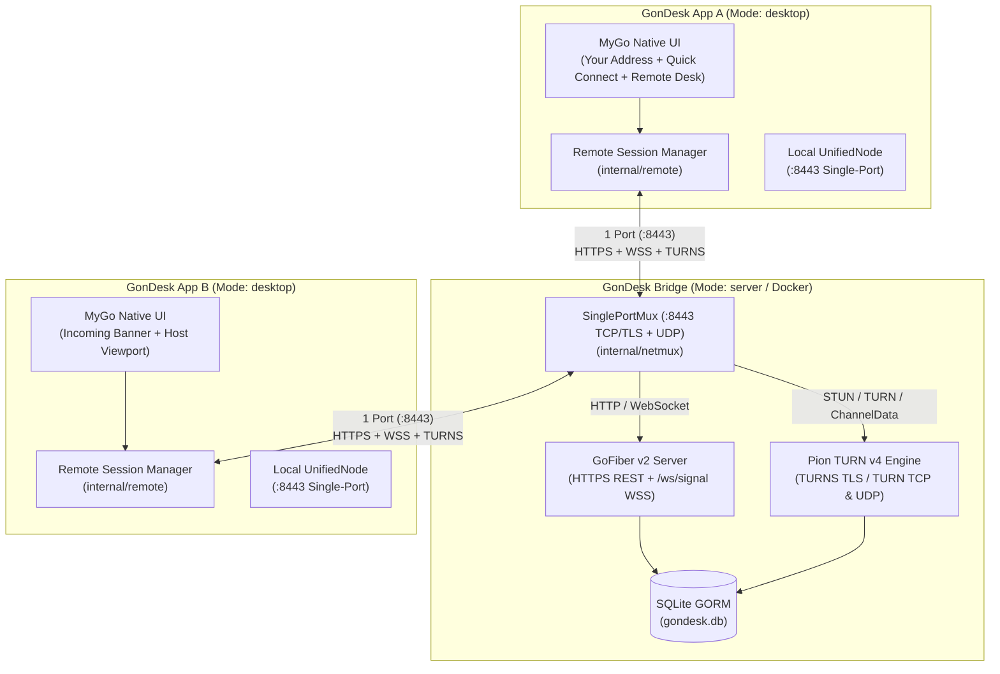
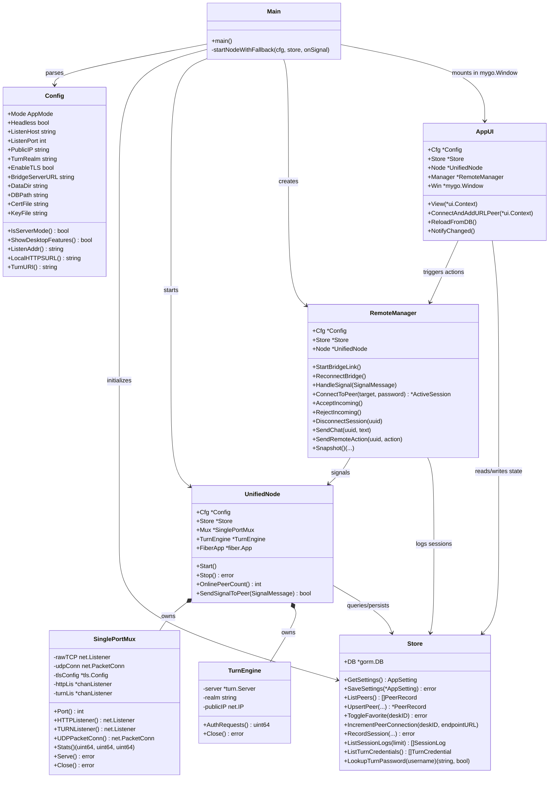
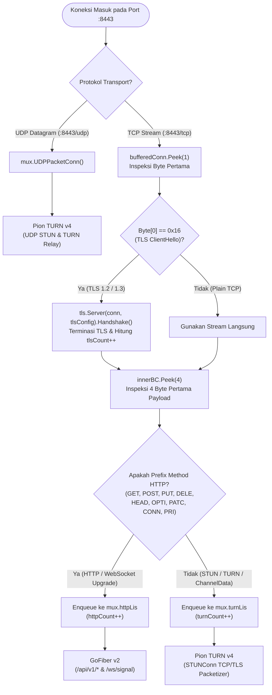
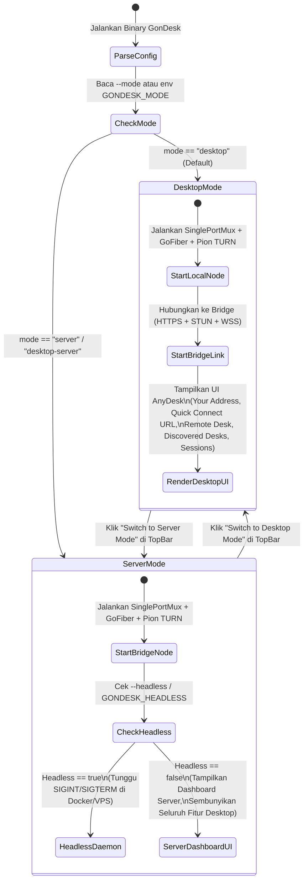
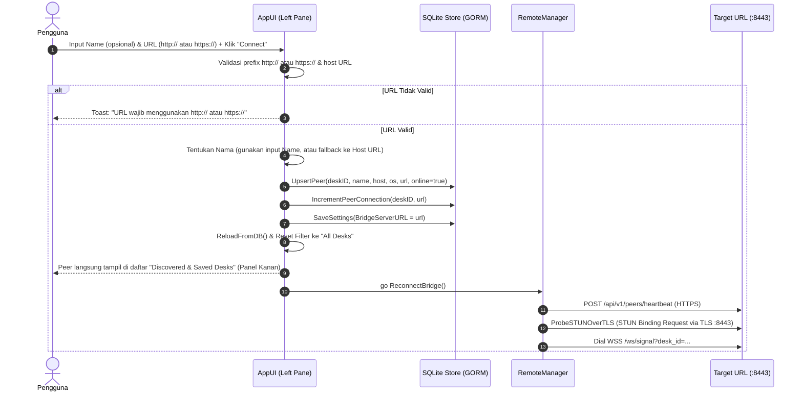
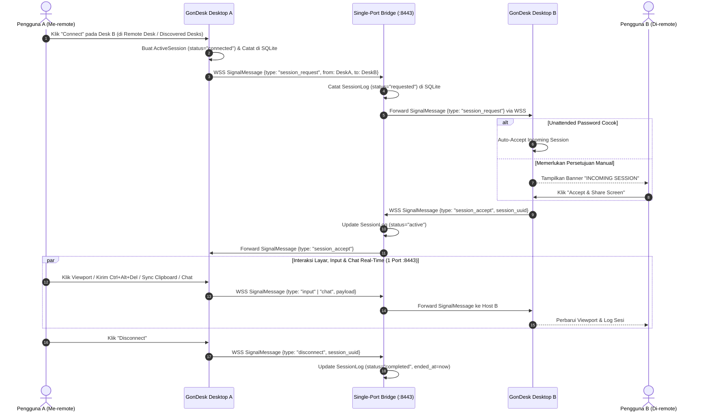
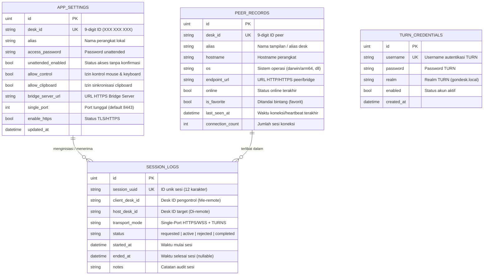
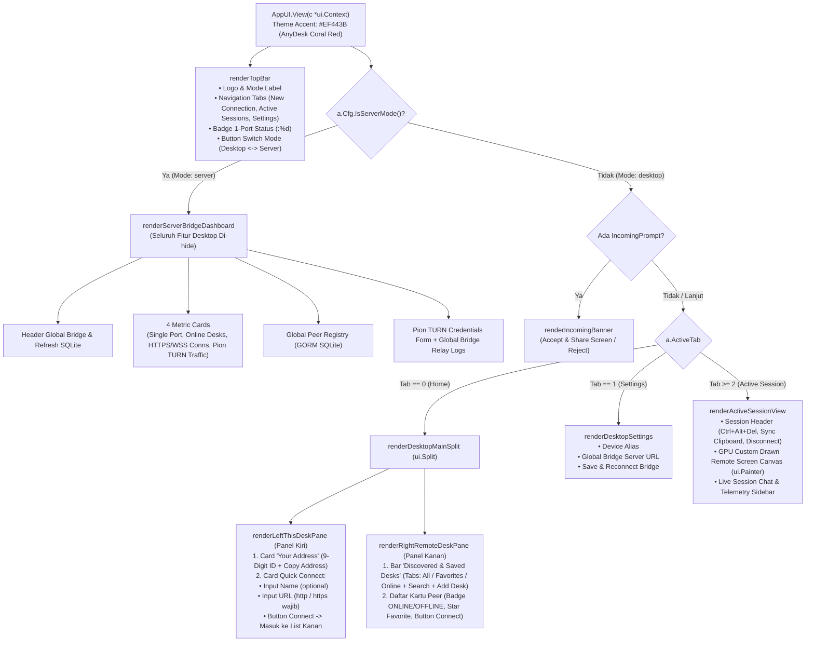
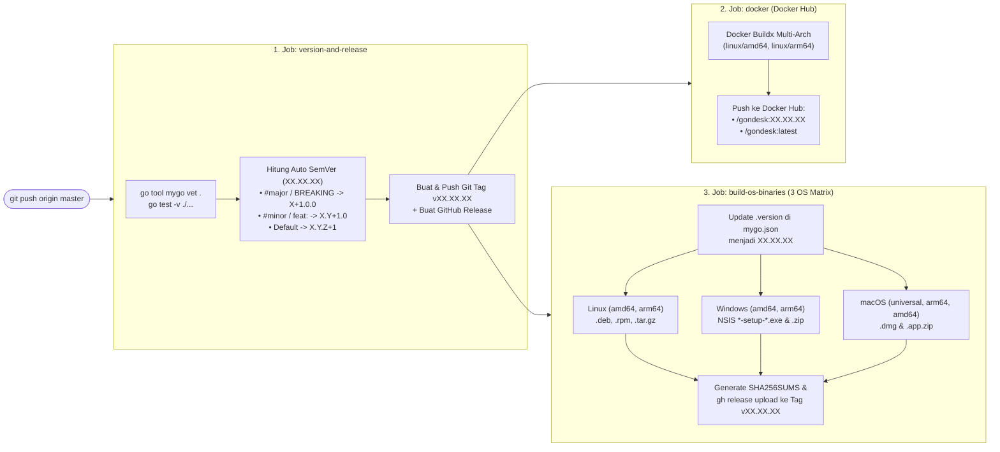

# GonDesk — Architecture & Engineering Knowledge Base (`KNOWLEDGE.md`)

Dokumen ini merupakan pusat dokumentasi teknis (**Knowledge Base**) untuk proyek **GonDesk**. Seluruh arsitektur, alur kerja internal, protokol jaringan *Single-Port*, skema database SQLite, hierarki **MyGo Native UI**, hingga *pipeline* CI/CD dituangkan secara menyeluruh di sini.

---

## 📑 Daftar Isi

1. [Gambaran Umum & Filosofi Desain](#1-gambaran-umum--filosofi-desain)
2. [Peta Modul & Struktur Direktori](#2-peta-modul--struktur-direktori)
3. [Arsitektur Single-Port Multiplexer (`internal/netmux`)](#3-arsitektur-single-port-multiplexer-internalnetmux)
4. [Mekanisme Dual-Mode dalam Satu Source Code (`desktop` vs `server`)](#4-mekanisme-dual-mode-dalam-satu-source-code-desktop-vs-server)
5. [Alur Koneksi, Signaling WebSocket & Sesi Remote (`internal/remote` & `internal/server`)](#5-alur-koneksi-signaling-websocket--sesi-remote-internalremote--internalserver)
6. [Skema Database GORM SQLite (`internal/database`)](#6-skema-database-gorm-sqlite-internaldatabase)
7. [Hierarki & Siklus Hidup MyGo Native UI (`internal/uiapp`)](#7-hierarki--siklus-hidup-mygo-native-ui-internaluiapp)
8. [Spesifikasi REST API & Protokol WebSocket](#8-spesifikasi-rest-api--protokol-websocket)
9. [Arsitektur Docker & CI/CD Auto-Versioning (`.github/workflows/release.yml`)](#9-arsitektur-docker--cicd-auto-versioning-githubworkflowsreleaseyml)
10. [Panduan Pengujian & Analisis Statis](#10-panduan-pengujian--analisis-statis)

---

## 1. Gambaran Umum & Filosofi Desain

**GonDesk** dirancang sebagai aplikasi *Remote Desktop* lintas platform (seperti AnyDesk) sekaligus *Global Bridge / TURN Relay Server* yang ditulis sepenuhnya dalam bahasa **Go murni (`CGO_ENABLED=0`)**.

### Empat Pilar Utama GonDesk

1. **Pure-Go Native GPU UI (`github.com/egoist/mygo/ui`)**:
   - Tidak menggunakan HTML, CSS, JavaScript, Node/Bun, ataupun WebView.
   - Antarmuka digambar langsung di atas GPU menggunakan **Metal** (macOS), **Direct3D 11** (Windows), dan **OpenGL / GTK 3** (Linux).
2. **Satu Source Code untuk Dua Bentuk Aplikasi (`desktop` & `server`)**:
   - **Mode `desktop` (Default)**: Berfungsi sebagai klien pengendali (*Me-remote* / *Remote Desk*) sekaligus host yang dapat dikendalikan (*Di-remote* / *Your Address*).
   - **Mode `server` (`desktop-server`)**: Berfungsi sebagai jembatan jaringan global (*Global Bridge & TURN Server*). Menggunakan binary dan kode sumber yang sama persis, tetapi seluruh fitur UI remote desktop disembunyikan (`ShowDesktopFeatures() == false`). Dapat berjalan dengan GUI dashboard maupun `--headless` di Docker/VPS.
3. **Koneksi Antar-Aplikasi Hanya Menggunakan 1 Port (`:8443`) + HTTPS**:
   - Seluruh trafik **HTTPS REST API**, **WebSocket Signaling (`wss://`)**, **STUN Binding**, **TURNS (`turns:` TCP/TLS)**, dan **TURN Relay (`turn:` UDP)** berjalan serentak di **1 nomor port yang sama** (default `:8443`).
4. **Zero External Dependencies (Embedded SQLite + Auto TLS)**:
   - Menggunakan driver SQLite Go murni (`github.com/glebarez/sqlite` + `gorm.io/gorm`) dan otomatis menghasilkan sertifikat TLS X.509 ECDSA P-256 (`certs/server.crt` & `certs/server.key`) saat pertama kali dijalankan.



---

## 2. Peta Modul & Struktur Direktori



### Tanggung Jawab Tiap Paket

| Paket / File | Lokasi | Tanggung Jawab Utama |
|---|---|---|
| `main` | [main.go](file:///Users/jefripunza/Documents/Projects/gondesk/main.go) | Entry point aplikasi, *port fallback* (`8443..8452`), inisialisasi `Store`, `UnifiedNode`, `Manager`, mode `--headless`, dan pembuatan window MyGo Native UI. |
| `internal/config` | [config.go](file:///Users/jefripunza/Documents/Projects/gondesk/internal/config/config.go) | Parsing CLI flags & environment variables (`GONDESK_MODE`, `GONDESK_PORT`, dll.) serta penentuan mode `desktop` vs `server`. |
| `internal/database` | [sqlite.go](file:///Users/jefripunza/Documents/Projects/gondesk/internal/database/sqlite.go) | Koneksi GORM SQLite murni (`glebarez/sqlite`), migrasi skema otomatis, data awal (*seed*), generator 9-digit Desk ID, dan operasi CRUD. |
| `internal/netmux` | [singleport.go](file:///Users/jefripunza/Documents/Projects/gondesk/internal/netmux/singleport.go), [tlscert.go](file:///Users/jefripunza/Documents/Projects/gondesk/internal/netmux/tlscert.go) | *Single-Port Multiplexer* (TCP/TLS + UDP pada port yang sama) dan pembuatan sertifikat TLS X.509 ECDSA P-256 otomatis. |
| `internal/turnserver` | [turn.go](file:///Users/jefripunza/Documents/Projects/gondesk/internal/turnserver/turn.go) | Server **Pion TURN v4** yang menerima koneksi TCP/TLS dari `mux.TURNListener()` dan paket UDP dari `mux.UDPPacketConn()`. |
| `internal/server` | [fiber_server.go](file:///Users/jefripunza/Documents/Projects/gondesk/internal/server/fiber_server.go) | Server **GoFiber v2** yang melayani REST API (`/api/v1/*`) dan hub WebSocket Signaling (`/ws/signal`) di atas `mux.HTTPListener()`. |
| `internal/remote` | [manager.go](file:///Users/jefripunza/Documents/Projects/gondesk/internal/remote/manager.go) | Manajemen sesi remote keluar (*outgoing*) dan masuk (*incoming*), *heartbeat* HTTPS, *probe* STUN-over-TLS (`ProbeSTUNOverTLS`), dan komunikasi WebSocket. |
| `internal/uiapp` | [app_ui.go](file:///Users/jefripunza/Documents/Projects/gondesk/internal/uiapp/app_ui.go) | Seluruh tampilan **MyGo Native UI** untuk Mode Desktop (AnyDesk-style) dan Mode Server (Global Bridge Dashboard). |

---

## 3. Arsitektur Single-Port Multiplexer (`internal/netmux`)

Salah satu keunggulan utama GonDesk adalah kemampuan melayani **HTTPS REST API**, **WebSocket (`wss://`)**, **TURNS (`turns:` TCP/TLS)**, dan **TURN/STUN UDP** hanya melalui **1 nomor port** (`:8443`).

### Cara Kerja `SinglePortMux`



### Detail Implementasi Penting
1. **Non-Destructive Byte Peeking (`bufferedConn`)**:
   - Membungkus `net.Conn` dengan `bufio.Reader` (`4096` bytes) sehingga pemanggilan `Peek(1)` (untuk deteksi TLS `0x16`) dan `Peek(4)` (untuk deteksi method HTTP) tidak mengonsumsi byte dari stream yang nantinya dibaca oleh `crypto/tls`, `GoFiber`, ataupun `pion/turn`.
2. **Sinkronisasi Port TCP & UDP (`NewSinglePortMux`)**:
   - Membuka `net.Listen("tcp", addr)` terlebih dahulu, mengambil nomor port aktual (`tcpLis.Addr().(*net.TCPAddr).Port` — sangat berguna saat testing dengan port `:0`), lalu membuka `net.ListenPacket("udp", ...)` pada nomor port yang persis sama.
3. **Auto Self-Signed Certificate (`LoadOrGenerateTLSConfig`)**:
   - Bila file `data/certs/server.crt` dan `data/certs/server.key` belum ada, aplikasi secara otomatis membangkitkan pasangan kunci **ECDSA P-256** dan sertifikat X.509 yang berlaku selama 365 hari untuk `localhost`, `gondesk.local`, `127.0.0.1`, dan `::1`.

---

## 4. Mekanisme Dual-Mode dalam Satu Source Code (`desktop` vs `server`)

GonDesk dikompilasi menjadi **satu binary tunggal** yang dapat berjalan dalam 2 mode berbeda:



### Perbandingan Fitur Berdasarkan Mode

| Komponen / Fitur | Mode `desktop` (`ShowDesktopFeatures() == true`) | Mode `server` (`ShowDesktopFeatures() == false`) |
|---|---|---|
| **Single-Port HTTPS + WSS + Pion TURN (`:8443`)** | ✅ Aktif | ✅ Aktif |
| **Database GORM SQLite (`gondesk.db`)** | ✅ Aktif | ✅ Aktif |
| **Panel "Your Address" (9-Digit ID & Di-remote)** | ✅ Ditampilkan | ❌ Disembunyikan (`Hidden`) |
| **Form Quick Connect (`Name` + `http/https URL`)** | ✅ Ditampilkan | ❌ Disembunyikan (`Hidden`) |
| **Daftar "Discovered & Saved Desks"** | ✅ Ditampilkan | ❌ Disembunyikan (`Hidden`) |
| **Incoming Session Approval Banner & Active Viewport** | ✅ Ditampilkan | ❌ Disembunyikan & Ditolak di Manager |
| **Global Bridge & TURN Server Admin Dashboard** | 🔄 Dapat diakses via Switch Mode | ✅ Tampilan Utama Default |

---

## 5. Alur Koneksi, Signaling WebSocket & Sesi Remote (`internal/remote` & `internal/server`)

### 5.1. Alur Quick Connect URL di Panel Kiri (`ConnectAndAddURLPeer`)

Ketika pengguna mengisi **Name (optional)** dan **URL (`http://` atau `https://`)** pada kartu di bawah *Your Address* lalu menekan tombol **Connect**:



### 5.2. Alur Sesi Remote Desktop (*Me-remote* & *Di-remote*)



---

## 6. Skema Database GORM SQLite (`internal/database`)

GonDesk menggunakan `gorm.io/gorm` dengan driver pure-Go `github.com/glebarez/sqlite` dalam mode **WAL (`journal_mode=WAL`)** dan `busy_timeout=5000`. Database disimpan secara default di `data/gondesk.db`.



---

## 7. Hierarki & Siklus Hidup MyGo Native UI (`internal/uiapp`)

Antarmuka pengguna dibangun menggunakan deklarasi *immediate-mode* `github.com/egoist/mygo/ui`.



### Aturan Penting MyGo Native UI yang Diterapkan
1. **Aturan Popup / Modal (Tidak Boleh Tertutup Saat Klik di Luar)**:
   - Sesuai aturan di [AGENT.md](AGENT.md), semua dialog popup/modal wajib memanfaatkan `.Dismissed()` dari `ui.Modal` untuk mengembalikan status `*open = true` jika pengguna mengklik backdrop luar atau menekan Escape secara tidak sengaja. Dialog **hanya boleh ditutup** melalui tombol eksplisit di dalam dialog (seperti tombol Cancel atau Save).
2. **Zero `ui.Element` / `*ui.Context` Persistence**:
   - Struct `AppUI` hanya menyimpan *state* data murni (`string`, `bool`, `int`, `float32`, slice model SQLite, dan `*mygo.Window`). Tidak ada `ui.Element` atau `*ui.Context` yang disimpan di dalam struct (diverifikasi dengan `go tool mygo vet .`).
3. **Stable Keys di Dalam Loop (`c.Key(...)`)**:
   - Setiap elemen yang di-render di dalam perulangan (`sessions`, `filteredPeers`, `SessionLogs`, `TurnCreds`, `ChatLog`) selalu diberi kunci unik menggunakan `c.Key(...)` agar state fokus dan klik tetap stabil antar-frame.
4. **Thread-Safe UI Update dari Goroutine Latar Belakang**:
   - Saat *event* WebSocket atau TURN masuk dari goroutine latar belakang, `Manager` memanggil `appUI.NotifyChanged()` yang mengeksekusi `a.Win.Update(func() { a.ReloadFromDB() })` pada *main thread*.

---

## 8. Spesifikasi REST API & Protokol WebSocket

Seluruh endpoint dilayani oleh **GoFiber v2** pada port tunggal yang sama dengan TURN (`https://<host>:<port>`):

### 8.1. Endpoint REST API

| Method | Path | Fungsi | Contoh Respons Utama |
|---|---|---|---|
| `GET` | `/api/v1/info` | Informasi status node, mode aktif, statistik koneksi HTTP/TURN/TLS, serta URI TURN. | `{"app":"gondesk","mode":"desktop","single_port":8443,"turn_uri":"turns:127.0.0.1:8443?transport=tcp",...}` |
| `GET` | `/api/v1/peers` | Mengambil daftar seluruh peer yang tersimpan/terdaftar di SQLite. | `{"peers":[...]}` |
| `POST` | `/api/v1/peers/heartbeat` | Mendaftarkan atau memperbarui status *online* & *endpoint URL* sebuah peer. | `{"status":"ok","peer":{...},"turn_uri":"..."}` |
| `GET` | `/api/v1/sessions` | Mengambil 30 riwayat sesi terakhir dari tabel `session_logs`. | `{"sessions":[...]}` |
| `GET` | `/api/v1/turn/credentials` | Mengambil kredensial aktif untuk otentikasi alokasi relay Pion TURN. | `{"realm":"gondesk.local","username":"gondesk","password":"...","port":8443}` |

### 8.2. Struktur Pesan WebSocket (`/ws/signal?desk_id=...&alias=...`)

```json
{
  "type": "session_request | session_accept | session_reject | chat | input | disconnect",
  "session_uuid": "a1b2c3d4e5f6",
  "from_desk_id": "482 910 374",
  "from_alias": "Workstation-MacPro",
  "to_desk_id": "816 692 488",
  "password": "optional-password",
  "transport": "Single-Port HTTPS/WSS + TURNS (:8443)",
  "payload": "Pesan chat atau aksi input remote",
  "timestamp": "23:35:10"
}
```

---

## 9. Arsitektur Docker & CI/CD Auto-Versioning (`.github/workflows/release.yml`)

Setiap `push` ke branch `master` menjalankan *pipeline* otomatis dari pengujian hingga distribusi lintas OS dan Docker Hub:



---

## 10. Panduan Pengujian & Analisis Statis

Proyek ini dilengkapi pengujian tanpa jendela (*headless UI test* menggunakan `ui.NewTester`) dan pengujian integrasi jaringan *Single-Port* di [main_test.go](file:///Users/jefripunza/Documents/Projects/gondesk/main_test.go):

1. **`TestDesktopAndServerModeViews`**:
   - Memastikan Mode `desktop` menampilkan **Your Address**, **Remote Desk**, dan Desk ID 9-digit.
   - Memastikan pengisian form **Quick Connect** (`Name` opsional + `URL` `https://...` + klik `Connect`) menambahkan peer baru langsung ke daftar **Discovered & Saved Desks**.
   - Memastikan saat beralih ke Mode `server`, fitur-fitur desktop disembunyikan dan tampilan beralih ke **GonDesk Global Bridge & TURN Server Mode**.
2. **`TestSinglePortHTTPSAndTURNAndWebSocket`**:
   - Memastikan pada **1 port acak yang sama**, request **HTTPS `GET /api/v1/info`**, **STUN Binding over TLS (`ProbeSTUNOverTLS`)**, dan **WebSocket Signaling + pencatatan SQLite** berjalan sukses secara bersamaan.

Perintah verifikasi lengkap:
```bash
# Analisis statis aturan lifetime & goroutine MyGo Native UI
go tool mygo vet .

# Menjalankan seluruh unit & integration test
go test -v ./...

# Memastikan kompilasi seluruh paket bersih
go build -v ./...
```

