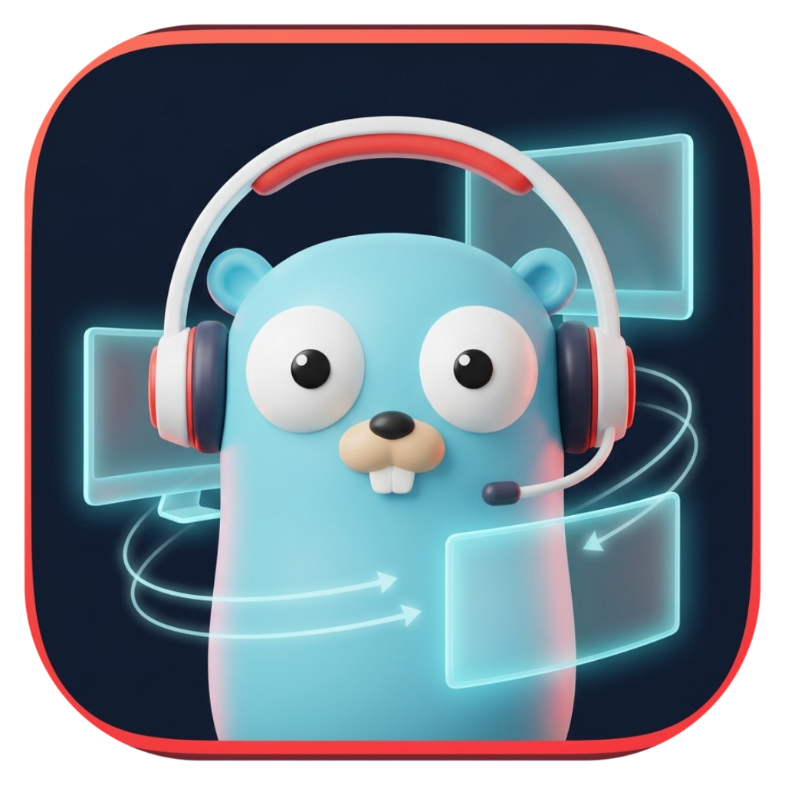
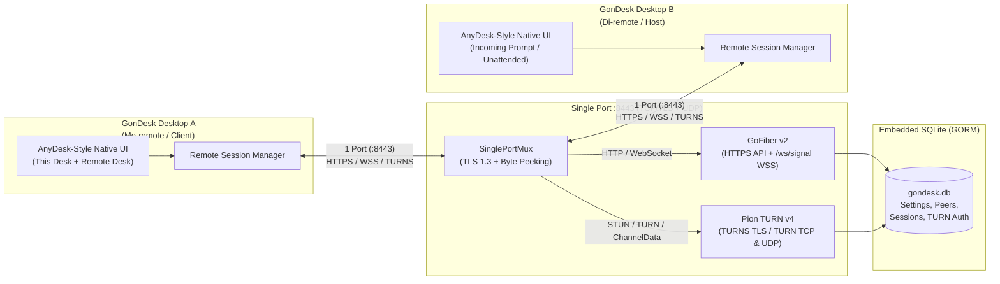

<div align="center">



# GonDesk

**Open-Source Cross-Platform Remote Desktop & Single-Port HTTPS/TURN Global Bridge in Pure Go**

[](https://go.dev/)
[](https://mygo.run/)
[](https://gofiber.io/)
[](https://github.com/pion/turn)
[-003B57?style=flat-square)](https://gorm.io/)
[](LICENSE)

*One codebase. Two runtime modes (**Desktop** & **Global Bridge Server**). One single network port (`:8443`) for **HTTPS**, **WSS**, and **TURNS/STUN**.*

[Features](#-key-features) •
[Architecture](#-single-port-architecture) •
[Quick Start](#-quick-start) •
[Docker Deployment](#-docker--server-deployment) •
[CLI & Env Reference](#️-configuration--flags) •
[API Reference](#-rest--websocket-api) •
[Contributing](CONTRIBUTING.md) •
[Security](SECURITY.md)

</div>

---

## ✨ Key Features

- **⚡ Pure-Go GPU Native UI (`github.com/egoist/mygo/ui`)**:
  - Built with [MyGo Native UI](https://mygo.run) (`CGO_ENABLED=0`) — renders directly on Metal (macOS), Direct3D 11 (Windows), and OpenGL/GTK3 (Linux) with zero HTML/JS/WebView overhead and instant startup.
- **🔀 Single Codebase, Dual Runtime Modes**:
  1. **Desktop Mode (`--mode=desktop`, default)**:
     - AnyDesk-inspired interface featuring **"This Desk"** (9-digit GonDesk ID, unattended password, incoming connection approval modal — *di-remote*) and **"Remote Desk"** (connect to remote peers, live screen viewport, remote actions, and session chat — *me-remote*).
  2. **Desktop Server / Global Bridge Mode (`--mode=server`)**:
     - Runs from the **exact same binary and source code**, but automatically **hides all Desktop remote-control client/host features**. Exposes a dedicated Global Bridge & TURN Server admin dashboard (or runs `--headless` on a VPS/Docker container).
- **🔌 True Single-Port Multiplexing (`:8443`)**:
  - Inter-app communication requires **only 1 open port** (TCP/TLS + UDP on the same port number):
    - **HTTPS REST API & WebSocket Signaling (`wss://`)** powered by **GoFiber v2**.
    - **STUN & TURN Relay (`turns:` TLS/TCP & `turn:` UDP)** powered by **Pion TURN v4**.
    - Automatic self-signed **ECDSA P-256 X.509 TLS certificate** generation on first boot (or bring your own Let's Encrypt / custom PEM certificates).
- **🗄️ Embedded Pure-Go SQLite with GORM**:
  - Zero external database dependencies. Uses `gorm.io/gorm` + `github.com/glebarez/sqlite` (`CGO_ENABLED=0`) to persist desk identity, address book peers, TURN credentials, and session audit logs.
- **📦 Automated Multi-OS & Docker Releases**:
  - GitHub Actions pipeline automatically versions (`vX.Y.Z`), builds & pushes multi-arch Docker images (`linux/amd64`, `linux/arm64`) to Docker Hub, and packages downloadable installers/binaries for **Linux** (`.deb`, `.rpm`, `.tar.gz`), **Windows** (`.exe` installer & portable `.zip`), and **macOS** (`.dmg` Universal/ARM64/Intel & `.app.zip`).

---

## 🏗️ Single-Port Architecture

GonDesk eliminates firewall headaches by multiplexing all signaling, REST APIs, and NAT traversal media relays over a **single port number** (default `:8443`):



### How the Single-Port Multiplexer (`internal/netmux`) Works
1. **TCP/TLS Listener (`:8443/tcp`)**:
   - Peeks at the first incoming byte. If it is `0x16` (TLS Handshake `ClientHello`), the connection is transparently unwrapped via `crypto/tls`.
   - Peeks at the first 4 decrypted bytes:
     - Standard HTTP methods (`GET `, `POST`, `PUT `, `DELE`, `HEAD`, `OPTI`, `PATC`, `CONN`, `PRI `) are routed to the **GoFiber v2** listener (serving HTTPS REST endpoints and `/ws/signal` WebSocket upgrades).
     - Non-HTTP frames (STUN Binding requests, TURN Allocate requests, and TURN ChannelData frames) are routed to the **Pion TURN v4** TCP/TLS listener.
2. **UDP Packet Listener (`:8443/udp`)**:
   - Bound to the exact same port number (`:8443/udp`) and passed directly to **Pion TURN v4** for low-latency UDP media relay.

---

## 🚀 Quick Start

### 1. Download Prebuilt Binaries
Download the latest installer or archive for **macOS**, **Windows**, or **Linux** from the [**GitHub Releases**](../../releases) page.

### 2. Run from Source

#### Prerequisites
- **Go 1.27.3+** (or Go 1.24+ with `GOTOOLCHAIN=auto`)
- **Linux only**: GTK 3 (`sudo apt install libgtk-3-0` on Ubuntu/Debian)
- **macOS 12+ / Windows 10+**: No extra dependencies required.

#### Run in Desktop Mode (Default — Can Remote & Be Remoted)
```bash
# Live-reload development mode via MyGo CLI
go tool mygo dev

# Or run directly with Go
go run . --mode=desktop --port=8443
```

#### Run in Desktop Server / Global Bridge Mode (Desktop UI Hidden)
```bash
# With Native Server Dashboard Window
GONDESK_MODE=server go tool mygo dev
# or:
go run . --mode=server --port=8443

# Headless Mode (for Linux VPS / Terminal / Docker without GUI)
go run . --mode=server --headless --host=0.0.0.0 --port=8443
```

---

## 🐳 Docker & Server Deployment

When deployed on a cloud server or VPS, GonDesk runs in **Server Mode (`--mode=server --headless`)** as a global signaling & TURN relay bridge over **1 port (`8443/tcp` and `8443/udp`)**.

### Option A: Docker Compose (Recommended)
```bash
# Set your server's public IP so Pion TURN advertises the correct relay address
export GONDESK_PUBLIC_IP="203.0.113.10"

docker compose up -d --build
```

### Option B: Docker CLI
```bash
# Build image locally (or pull from Docker Hub)
docker build -t gondesk:latest .

# Run on single port 8443 (both TCP and UDP)
docker run -d \
  --name gondesk-bridge \
  --restart unless-stopped \
  -p 8443:8443/tcp \
  -p 8443:8443/udp \
  -e GONDESK_MODE=server \
  -e GONDESK_HEADLESS=true \
  -e GONDESK_PUBLIC_IP=203.0.113.10 \
  -e GONDESK_PORT=8443 \
  -v gondesk_data:/data \
  gondesk:latest
```

Verify the server is live over HTTPS on port `8443`:
```bash
curl -k https://127.0.0.1:8443/api/v1/info
```

Then, in any **GonDesk Desktop** client:
1. Open the **Settings & Bridge** tab.
2. Set **Global Bridge URL (HTTPS)** to `https://203.0.113.10:8443`.
3. Click **Save & Reconnect Bridge**. Both Desktop apps can now connect globally across NAT/firewalls using that single port!

---

## ⚙️ Configuration & Flags

GonDesk can be configured via CLI flags or environment variables:

| CLI Flag | Environment Variable | Default | Description |
|---|---|---|---|
| `--mode` | `GONDESK_MODE` | `desktop` | Runtime mode: `desktop` (full remote desktop client + host) or `server` (global bridge server, desktop UI hidden) |
| `--headless` | `GONDESK_HEADLESS` | `false` | Run without opening a GUI window (ideal for VPS/Docker in `server` mode) |
| `--host` | `GONDESK_HOST` | `0.0.0.0` | Bind address for the single-port listener |
| `--port` | `GONDESK_PORT` | `8443` | Single port number used simultaneously for HTTPS, WSS, and TURN (TCP/TLS & UDP) |
| `--bridge` | `GONDESK_BRIDGE_URL` | `https://127.0.0.1:8443` | Global Bridge Server HTTPS URL |
| `--public-ip` | `GONDESK_PUBLIC_IP` | `127.0.0.1` | Public IPv4 address advertised by Pion TURN relay allocations |
| `--realm` | `GONDESK_TURN_REALM` | `gondesk.local` | Realm name for Pion TURN authentication |
| `--tls` | `GONDESK_TLS` | `true` | Enable TLS 1.3 (`https://`, `wss://`, `turns:`) on the single port |
| `--data-dir` | `GONDESK_DATA_DIR` | `./data` | Directory for `gondesk.db` SQLite database and `certs/` |
| `--cert` | `GONDESK_CERT_FILE` | `./data/certs/server.crt` | Path to TLS certificate PEM file (auto-generated if missing) |
| `--key` | `GONDESK_KEY_FILE` | `./data/certs/server.key` | Path to TLS private key PEM file (auto-generated if missing) |

---

## 📡 REST & WebSocket API

All endpoints are served over the single port (`https://<host>:<port>`):

| Method | Endpoint | Description |
|---|---|---|
| `GET` | `/api/v1/info` | Node status, runtime mode, Desk ID, single-port stats (HTTP, TURN, TLS handshakes), and online peer count |
| `GET` | `/api/v1/peers` | List registered/discovered peers from SQLite |
| `POST` | `/api/v1/peers/heartbeat` | Register or refresh a Desktop peer's online status and endpoint |
| `GET` | `/api/v1/sessions` | Retrieve recent remote desktop session audit logs |
| `GET` | `/api/v1/turn/credentials` | Fetch active TURN realm, URI (`turns:<host>:<port>?transport=tcp`), and credentials |
| `GET` | `/ws/signal?desk_id=...` | Full-duplex WebSocket (`wss://`) signaling channel for session requests, approval, input events, and live chat |

---

## 📦 Building Multi-OS Packages Locally

Because GonDesk uses pure Go (`CGO_ENABLED=0`), you can cross-compile for **macOS**, **Windows**, and **Linux** from any machine using the pinned MyGo CLI tool:

```bash
# Build for your current OS
go tool mygo build

# Cross-compile for macOS, Windows, and Linux simultaneously
go tool mygo build -platform darwin/universal,windows/amd64,linux/amd64
```

Build artifacts are placed in `build/<os>-<arch>/`.

---

## 🔄 CI/CD & Auto-Versioning (`.github/workflows/release.yml`)

Every push to the `master` branch triggers the automated release workflow:
1. **Static Analysis & Tests**: Runs `go tool mygo vet .` and `go test -v ./...`.
2. **Automatic Semantic Versioning (`XX.XX.XX`)**:
   - Reads the latest `vX.Y.Z` Git tag and automatically bumps the version:
     - Commit message with `#major` or `BREAKING CHANGE` → bumps **Major** (`X+1.0.0`)
     - Commit message with `#minor` or `feat:` → bumps **Minor** (`X.Y+1.0`)
     - Any other commit → bumps **Patch** (`X.Y.Z+1`)
   - Creates and pushes the new Git tag `vX.Y.Z` and initializes the GitHub Release.
3. **Docker Hub Push**:
   - Builds multi-architecture (`linux/amd64`, `linux/arm64`) Docker images from [`Dockerfile`](Dockerfile) and pushes `<username>/gondesk:<version>` and `<username>/gondesk:latest` to Docker Hub.
   - *Required Repository Secrets*: `DOCKERHUB_USERNAME` and `DOCKERHUB_TOKEN`.
4. **3-OS Release Binaries**:
   - Builds native packages for **Linux** (`amd64`, `arm64`), **Windows** (`amd64`, `arm64`), and **macOS** (`universal`, `arm64`, `amd64`), generates `SHA256SUMS`, and attaches all downloadable files directly to the `vX.Y.Z` GitHub Release tag.

---

## 📂 Project Structure

```text
gondesk/
├── main.go                          # Application entry point (Desktop & Server modes)
├── main_test.go                     # Headless UI tests & Single-Port HTTPS+TURN+WSS tests
├── mygo.json                        # MyGo Native UI app metadata & packaging config
├── Dockerfile                       # Multi-stage production Dockerfile for Server mode
├── docker-compose.yml               # One-command Single-Port Bridge Server deployment
├── internal/
│   ├── config/
│   │   └── config.go                # Dual-mode flags, env vars & single-port configuration
│   ├── database/
│   │   └── sqlite.go                # GORM + pure-Go SQLite models & store
│   ├── netmux/
│   │   ├── singleport.go            # Single-port TCP/TLS + UDP protocol multiplexer
│   │   └── tlscert.go               # Auto self-signed ECDSA P-256 TLS cert generator
│   ├── turnserver/
│   │   └── turn.go                  # Pion TURN v4 server bound to the single port
│   ├── server/
│   │   └── fiber_server.go          # GoFiber v2 REST API + WebSocket signaling hub
│   ├── remote/
│   │   └── manager.go               # Outgoing/Incoming session manager & STUN/TLS probe
│   └── uiapp/
│       └── app_ui.go                # AnyDesk-style Native UI & Server Mode Dashboard
├── resources/
│   └── icon.png                     # 1024x1024 application icon
└── .github/
    ├── workflows/
    │   └── release.yml              # Auto-semver, Docker Hub push & 3-OS release pipeline
    ├── ISSUE_TEMPLATE/              # Bug report & feature request templates
    └── PULL_REQUEST_TEMPLATE.md     # Pull request checklist
```

---

## 🤝 Contributing & Community

We welcome contributions from the community!
- Read our [**Contributing Guide (`CONTRIBUTING.md`)**](CONTRIBUTING.md) to get started with development, testing, and pull requests.
- Please adhere to our [**Code of Conduct (`CODE_OF_CONDUCT.md`)**](CODE_OF_CONDUCT.md).
- Found a security vulnerability? Please review our [**Security Policy (`SECURITY.md`)**](SECURITY.md).

---

## 📄 License

Distributed under the **MIT License**. See [`LICENSE`](LICENSE) for full details.

